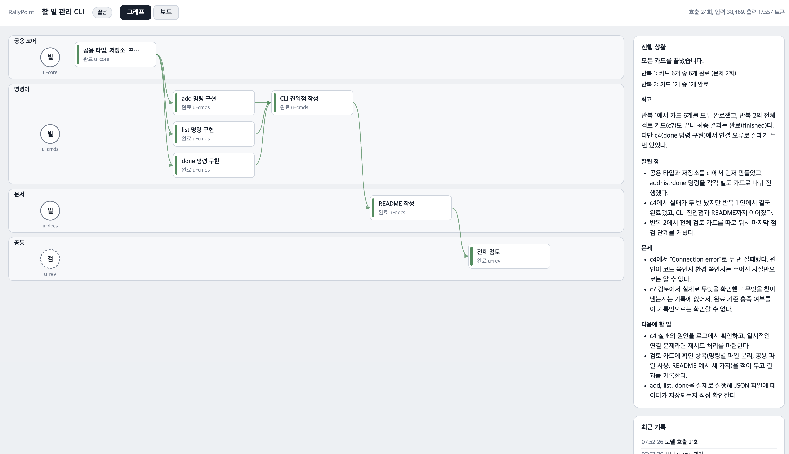
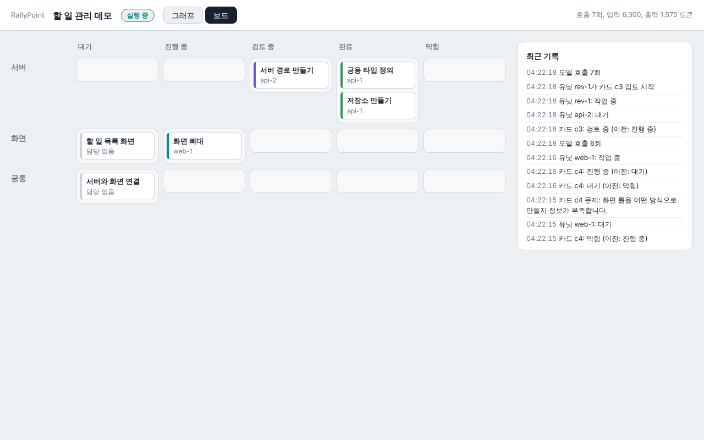

# RallyPoint

목표를 글로 적으면, 여러 AI 유닛이 역할을 나눠 프로젝트를 만들어 주는 도구입니다. Claude API로 동작하고, 누가 무엇을 하고 있는지 브라우저에서 노드 그래프로 볼 수 있습니다.



실제 Claude API로 샘플 시나리오를 돌린 결과입니다(모델 호출 24회). 일시적인 연결 오류 두 번은 자동으로 다시 시도해 넘어갔고, 오른쪽에 반복별 보고와 모델이 쓴 회고가 나옵니다.

## 어떻게 동작하나

1. 사용자가 시나리오 파일(목표, 제약, 완료 기준)을 줍니다.
2. **Planner**가 영역, 유닛, 카드(작은 작업)로 나눈 계획을 냅니다. 목표가 모호하면 질문을 한 번 합니다. 사용자가 승인하거나 수정을 요청합니다.
3. **Builder** 유닛이 칸반처럼 자기 영역의 카드를 가져가 파일 변경을 제안하고, **Reviewer** 유닛이 완료 기준에 비추어 승인하거나 반려합니다. 반려되면 지적 사항과 함께 다시 합니다.
4. `--iterations`로 허용하면, 한 반복이 끝난 뒤 Planner가 목표가 이미 이뤄졌는지 판단하고 부족하면 새 카드를 제안합니다. 사용자가 승인하면 이어서 실행합니다.
5. 끝나면 반복별 숫자 보고와 모델이 쓴 회고가 나옵니다.

핵심 원칙은 **판단과 집행의 분리**입니다. 무엇을 할지는 모델이 판단하지만, 카드 선행 관계, 동시 실행 한도, 쓰기 범위, 파일 버전 충돌, 막힌 카드가 생기면 일시정지하는 규칙은 모델이 아니라 오케스트레이터 코드가 강제합니다. 모델이 규칙을 어기려 해도 코드가 거부합니다.

## 시작하기

필요한 것: Node.js 22 이상, Anthropic API 키.

```
npm install
cp .env.example .env       # ANTHROPIC_API_KEY와 ANTHROPIC_MODEL을 채운다
npm run build
npm test
```

API 키 없이 화면만 먼저 보려면:

```
npm run demo               # http://127.0.0.1:3001 에서 계획을 승인하면 가짜 진행 상황이 흘러갑니다
```

실제로 돌리려면(작업 폴더는 비어 있어야 합니다):

```
npm run rally -- scenarios/sample-todo-cli.md ~/Desktop/todo-out --dashboard
```

| 옵션 | 설명 |
| --- | --- |
| `--dashboard` | 브라우저 대시보드를 켜고, 질문과 승인을 터미널 대신 브라우저에서 받습니다 |
| `--port=3001` | 대시보드 포트 |
| `--iterations=N` | 반복 번호 상한(기본 1). 2 이상이면 한 반복이 끝날 때마다 Planner가 다음 반복의 새 카드를 제안하고, 승인하면 이어서 실행합니다 |
| `--no-retro` | 끝난 뒤 회고를 쓰지 않습니다(모델 호출 1회 절약) |

모델 호출은 비용이 듭니다. 계획 승인 화면에 예상 호출 횟수가 나오고, 대시보드 위쪽에 누적 호출과 토큰이 표시됩니다.

## 시나리오 쓰기

Markdown 파일 하나입니다. `scenarios/sample-todo-cli.md`(한 번에 끝나는 작은 예)와 `scenarios/sample-todo-tags.md`(여러 반복으로 키우는 예, `--iterations=3`)를 참고하세요.

```
# 제목

## 목표
(필수) 무엇을 만들지

## 제약
(선택) 지켜야 할 것

## 완료 기준
(선택) 끝났다고 볼 조건
```

## 대시보드

- **그래프:** 영역은 가로 띠, 유닛은 왼쪽 원, 카드는 선행 관계 순서로 놓입니다. 작업 중인 유닛에서 카드로 점선이 흐르고(작업은 청록, 검토는 보라), 충돌은 빨간 점선으로 표시됩니다.
- **보드:** 영역과 상태로 나눈 칸반입니다.
- 계획 승인, 질문 답변, 막힌 카드의 다시 시도/멈추기를 오른쪽 패널에서 처리합니다. 다시 시도할 때 "추가 안내"를 적으면 그 카드를 다시 하는 유닛이 읽습니다. 모든 유닛은 시나리오의 목표, 제약, 완료 기준을 항상 함께 받습니다.



대시보드는 이 컴퓨터(127.0.0.1)에서만 접속됩니다. 인증이 없으므로 바깥에 열지 마세요.

## 구조

```
packages/
  shared/   유닛, 카드, 계획, 이벤트 같은 공용 타입
  server/   보드 규칙, 작업공간, 유닛 실행기, 오케스트레이터, Planner, 세션, 대시보드 서버, CLI
  ui/       대시보드 화면(의존성 없는 TypeScript와 SVG)
scenarios/  예시 시나리오
claude/     설계 결정 기록(decisions.md)
```

설계 결정과 그 이유는 [claude/decisions.md](claude/decisions.md)에 날짜별로 적어 두었습니다.

## 알려진 한계

- 생성한 코드를 실제로 실행해서 검증하지는 않습니다. 검토는 모델의 판단입니다.
- 한 번에 세션 하나만 다룹니다.
- 다음 반복은 새 카드만 추가할 수 있고, 영역과 유닛은 처음 계획 그대로입니다.
- Scheduler(일정 조율 유닛)는 아직 분리하지 않았습니다.
- Windows에서는 아직 확인하지 않았습니다(macOS에서 개발했습니다).
